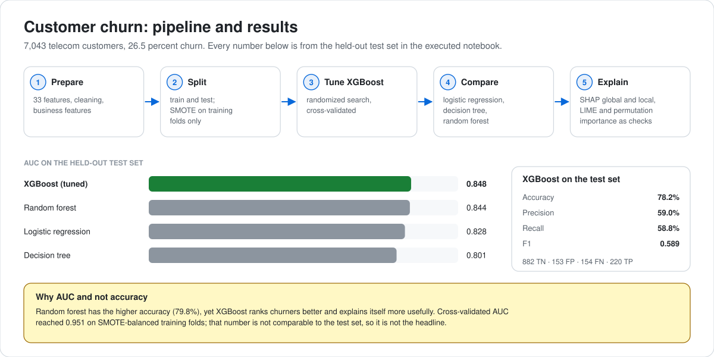

# Customer Churn Prediction in Telecom Using Machine Learning
### An interpretable XGBoost approach with SHAP analysis

<p>
       <a href="LICENSE"></a>
</p>

**Karan Tushar Parekh** · MS Data Science thesis, Liverpool John Moores University · October 2025

<picture>
  <source media="(prefers-color-scheme: dark)" srcset="assets/pipeline-results-dark.svg">
  
</picture>

---

## Overview

An interpretable pipeline that predicts which telecom customers will leave, explains why for each customer, and puts a value on acting on it.

- An interpretable binary classifier for churn, tuned and compared against three baselines
- **Global and local** explanations with SHAP, checked with LIME and permutation importance
- A **modelled retention scenario** that turns the predictions into a cost and benefit estimate

---

## Results

Held-out test set, taken directly from the executed notebook.

| Model | Accuracy | Precision | Recall | F1 | AUC |
|-------|---------:|----------:|-------:|---:|----:|
| Logistic Regression | 75.5% | 53.0% | 69.5% | 0.601 | 0.828 |
| Decision Tree | 77.1% | 55.8% | 67.1% | 0.609 | 0.801 |
| Random Forest | 79.8% | 62.6% | 59.1% | 0.608 | 0.844 |
| **XGBoost (optimized)** | **78.2%** | **59.0%** | **58.8%** | **0.589** | **0.848** |

XGBoost gives the best AUC and the most usable SHAP behaviour, which is why it is the model carried forward. Random Forest edges it on raw accuracy, a reminder that accuracy alone is the wrong headline metric on an imbalanced churn target.

XGBoost confusion matrix: 882 true negatives, 153 false positives, 154 false negatives, 220 true positives.

Best cross-validated AUC during hyperparameter search was 0.951, measured on SMOTE-balanced training folds, so it is not comparable to the test figures above.

---

## Retention scenario (modelled)

The notebook turns the model into a business estimate. The inputs are **assumptions set in the notebook**, not measured outcomes: a customer lifetime value of $2,100, a retention cost of $50 per customer contacted, and a 15 percent reduction in churn among those contacted.

| | |
|---|---|
| Customers | 7,043 |
| Churn rate | 26.5% |
| High-risk customers contacted | 2,324 |
| Customers retained (15% of churners) | 280 |
| Retention value | $588,000 |
| Campaign cost | $116,200 |
| **Net benefit** | **$471,800** |
| **Return on the campaign** | **406%** |

---

## Dataset

- **File:** `Telco_customer_churn.xlsx`
- **Records:** 7,043 customers, 33 features: demographics, services, CLTV, churn score and churn reason
- **Target:** `Churn Label` (Yes or No)
- 11 engineered business features, including CLTV segments, churn risk levels and geographic churn rates

## Notebook

`enhanced_customer_churn.ipynb`, in order: setup, data loading, preprocessing and feature engineering, train and test split with SMOTE on training data only, XGBoost hyperparameter search, baseline comparison, evaluation, SHAP analysis, LIME and permutation importance, the retention scenario, and model export.

## Run it

```bash
git clone https://github.com/karanparekh14/CUSTOMER-CHURN-PREDICTION-IN-TELECOM-USING-MACHINE-LEARNING.git
cd CUSTOMER-CHURN-PREDICTION-IN-TELECOM-USING-MACHINE-LEARNING
pip install numpy pandas scikit-learn xgboost shap lime imbalanced-learn plotly seaborn openpyxl
jupyter notebook enhanced_customer_churn.ipynb
```

## Next steps

1. A wider hyperparameter search (200+ iterations)
2. Feature selection before tuning
3. A voting ensemble of the strongest models
4. Drift monitoring, and an A/B test of the retention campaign before trusting the scenario numbers

## License

[MIT](LICENSE)
